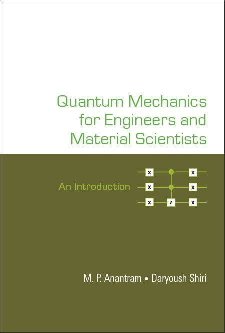

Quantum Mechanics for Engineers and Material Scientists: An Introduction

By M. P. Anantram and Daryoush Shiri

This book is an introductory text aimed at students of engineering and material science who want to learn the necessary tools of practical quantum mechanics. The authors provide a lucid exposition of modern topics such as quantum computing, quantum gates, two-level systems, orbitals, spin, periodic solids, tunneling, and Fermi’s golden rule. The book features well-designed examples that help the reader grasp and digest the concepts before moving to the next one. It also covers the basics of electronic and optical properties of nanomaterials using the fundamentals of quantum mechanics. The authors use analogies based on familiar engineering concepts wherever possible to broaden the reader’s understanding. The book’s philosophy is to teach by showing how quantum mechanics is done by using “pictures” worth a thousand words.

---

## Accompanying Material

Most chapters have accompanying Powerpoint slides available. Some chapters have accompanying audio slides available.

[Link to all slides](https://drive.google.com/drive/folders/1K8SuoAASApZ3cMQsEk9dJgxbgPB_WHBr)

[Link to all audio slides](https://drive.google.com/open?id=1gKA1LixQyXUMaHT-xoUqBRwcSZOFRVwm&usp=drive_fs)
