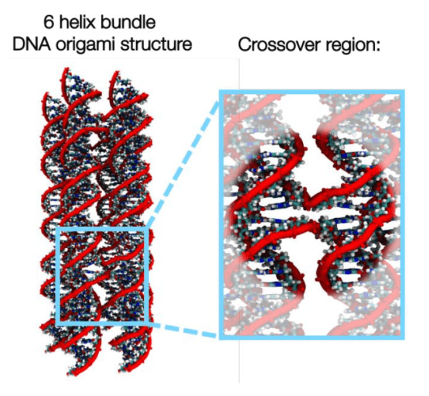
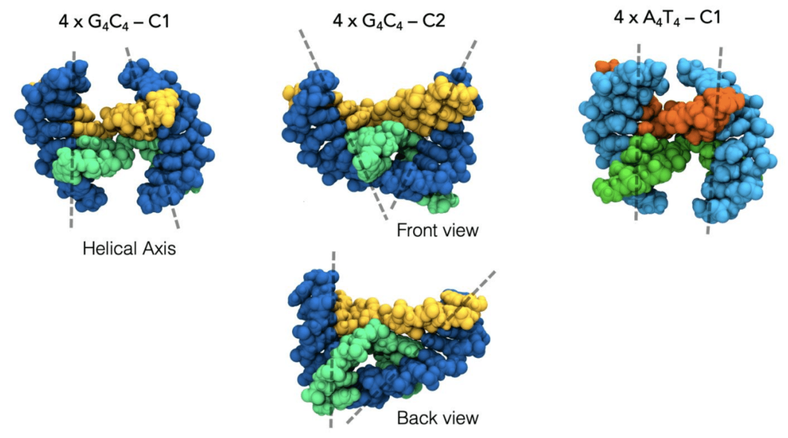
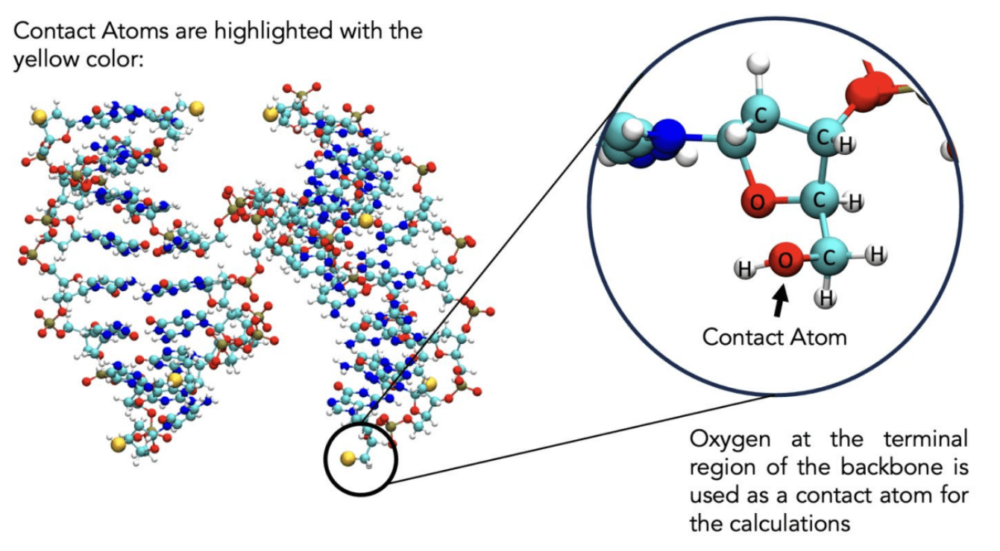
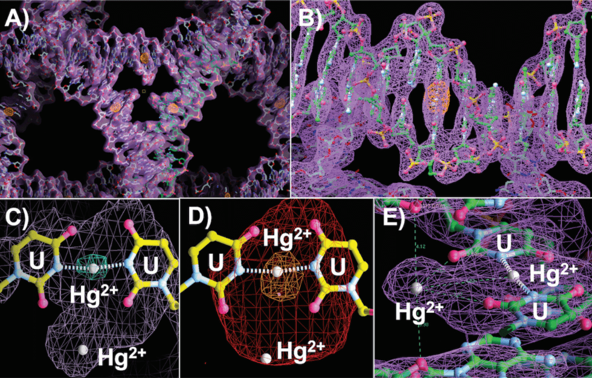
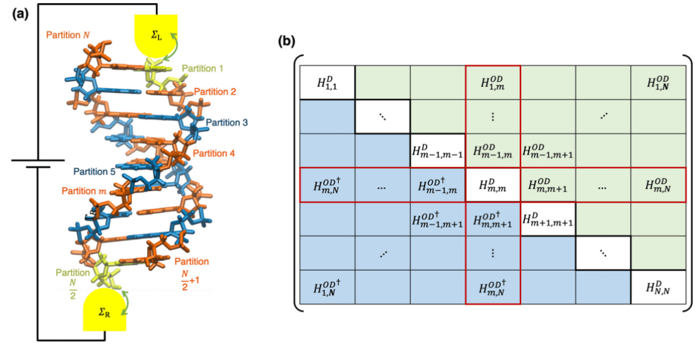
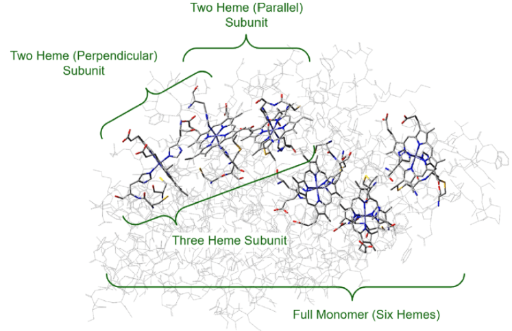
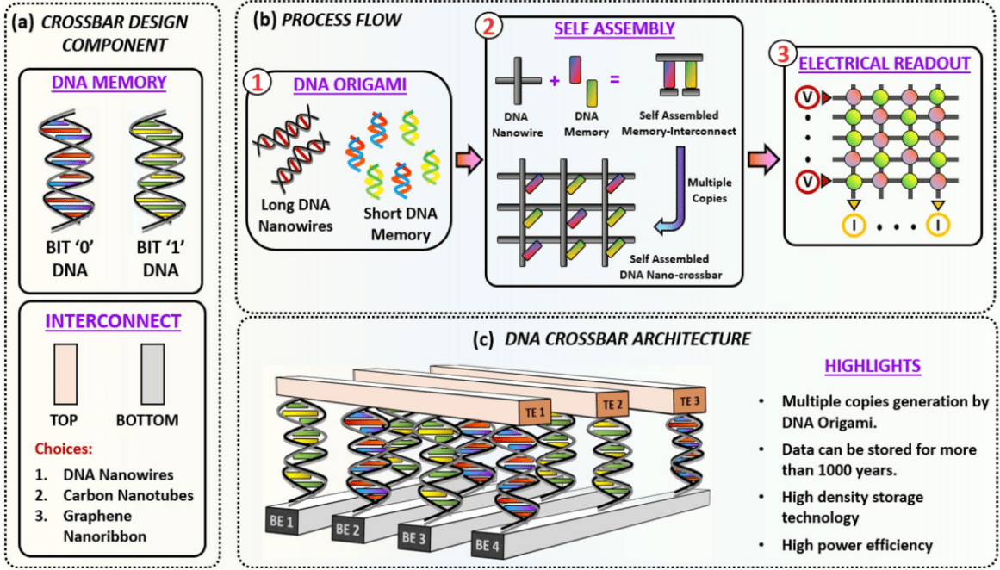
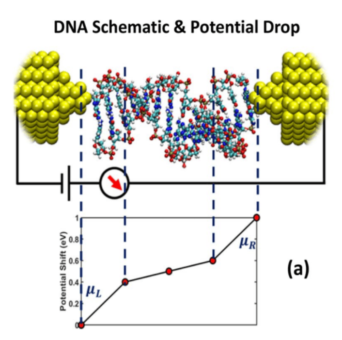
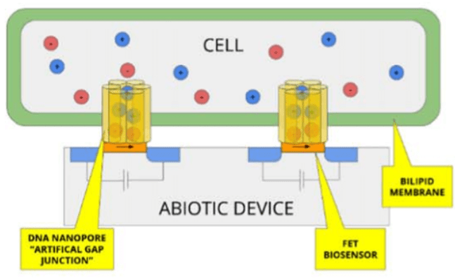
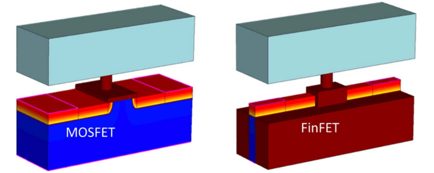

The Anantram Research Group at the University of Washington develops theoretical and computational approaches for understanding quantum transport in nanoscale systems. Our research spans DNA nanotechnology, quantum devices, molecular electronics, graphene, low-dimensional materials, and emerging technologies for quantum information processing.

We seek to understand how electrons, phonons, spins, and quantum states behave in structures whose dimensions are comparable to fundamental quantum length scales. Our work combines physics, electrical engineering, materials science, and advanced numerical simulation to address challenges in future computing technologies.

## Quantum Transport

Quantum transport lies at the center of modern nanoelectronics. As devices shrink to nanometer dimensions, classical descriptions of charge flow become inadequate and quantum mechanical effects dominate device behavior. Our group develops models and simulation techniques for electron transport through nanoscale conductors, molecular systems, low-dimensional materials, and quantum devices.

Research topics include:

- Non-equilibrium Green's function (NEGF) methods
- Ballistic and quasi-ballistic transport
- Quantum conductance
- Coherent and incoherent transport
- Electron-phonon interactions
- Tunneling phenomena
- Nanoscale device simulation
- DNA Nanotechnology

## Directions of Focus

### I. DNA and Protein Nanostructures

We are interested in understanding how to enhance the conductance of biomolecules (proteins and DNA) and build interesting heterostructures out of them.

#### Project Areas

1. Topological effects in peptides and DNA
2. Force field development for hybrid DNA structures
3. Electrical contacts to biomolecules
4. Device ideas
5. Use of machine learning to understand experimental conductance traces through molecular structures ([see our Github code](https://github.com/ethanwyr/SMBJClassifier))

<figure class="gallery-item"></figure>
<figure class="gallery-item"></figure>
<figure class="gallery-item"></figure>
<figure class="gallery-item"></figure>

## II. Theory and Algorithms

We work on the theory and algorithms involved in modeling the equations that govern quantum transport, with decoherence included. Our interest lies in both systems that are crystalline/periodic and those without an obvious underlying periodicity. We model decoherence both withing the context of a phonon both that interacts with the electrons and with a hierarchy of models using decoherence probes.

<figure class="gallery-item"></figure>
<figure class="gallery-item"></figure>

## III. Memory Devices

We explore new concepts for memory devices such a DNA memory, and also explore emerging device ideas based on resistive memory and phase change memory. Our modeling methods to explore these topics range from ab initio molecular dynamics to kinetic monte carlo simulation to Green’s function methods to simple resistive networks.

<figure class="gallery-item"></figure>
<figure class="gallery-item"></figure>

## IV. Neuromorphic devices and materials

We are trying to understand ion intercalation in two-dimensional materials. One of the goals of this effort is to investigate if we can build neuromorphic devices and control switching characteristics. We have just started two projects on this recently, working with a highly interdisciplinary team consisting of collaborators from material science, chemistry, device fabrication and circuits.

<figure class="gallery-item"></figure>
<figure class="gallery-item"></figure>

