## Past Post-Doctoral Fellows

<figure class="portrait"><a href="/images/bfb60556-UW-Website-Theme-Update.jpg">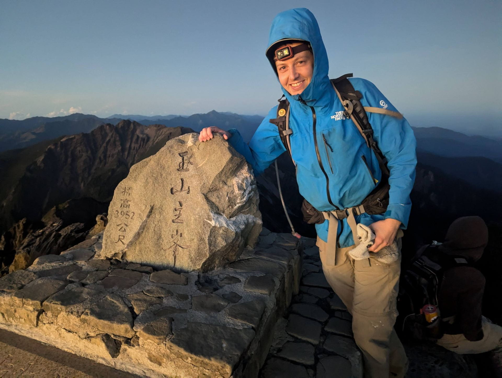</a></figure>

### William Livernois

William Livernois continued as a postdoc in our group before moving to Wesleyan University in November 2006

Email: [willll@uw.edu](mailto:willll@uw.edu)

LinkedIn: <https://www.linkedin.com/in/willlivernois>

GitHub: <https://github.com/wliverno>



<figure class="portrait"><a href="/images/1dc32026-fc490f0d-c674-4550-abb1-1af68fc84dea.jpg">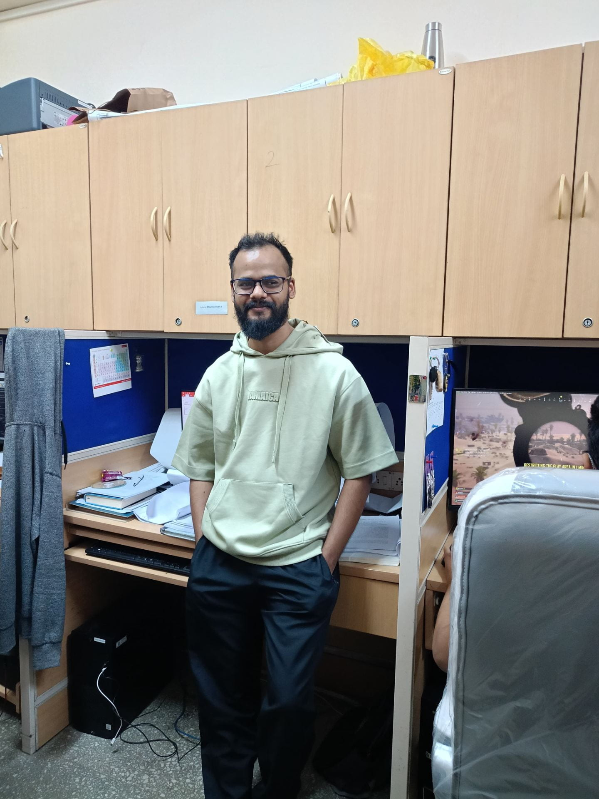</a></figure>

### Krishnakant Vishwakarma

Email: [krishnatifr@gmail.com](mailto:krishnatifr@gmail.com)



## Past PhD Students

<figure class="portrait"></figure>

### William Livernois

William Livernois was a 5th year PhD student in the Quantum Devices lab. William’s work includes developing quantum transmission models for biological systems such as cytochromes, investigating spin-dependent transport mechanisms in biological systems, and applying ab-initio modeling to metal-modified DNA structures. Prior to his PhD, William earned dual B.S. degrees in Chemical Engineering and Physics from MIT before working in industry as an R&D engineer for four years. His work focused on optimizing chemical vapor deposition systems for nanomaterials synthesis and developing characterization methods for quality control.

Email: [willll@uw.edu](mailto:willll@uw.edu)

LinkedIn: <https://www.linkedin.com/in/willlivernois>

GitHub: <https://github.com/wliverno>

<figure class="portrait"><a href="/images/9c546b66-Dub_2024.jpg">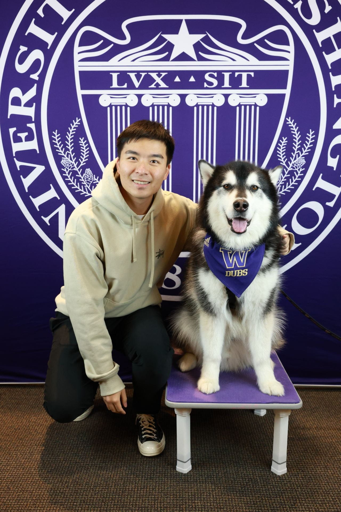</a></figure>

### Yiren Wang

Yiren (Ethan) Wang was a 5th year PhD student in the Quantum Devices lab. He received his B.S. and M.S. degrees in Electrical and Computer Engineering from the University of Washington, in 2019 and 2021.

Email: [ethanwyr@uw.edu](mailto:ethanwyr@uw.edu)

LinkedIn: <https://www.linkedin.com/yi-ren-wang>

GitHub: <https://github.com/ethanwyr>

## Past Undergraduate Researchers (EE499)

<section class="team-member past-undergraduate-member" markdown="1">

<figure class="portrait"><a href="/images/7c795cd0-hyuan.jpg">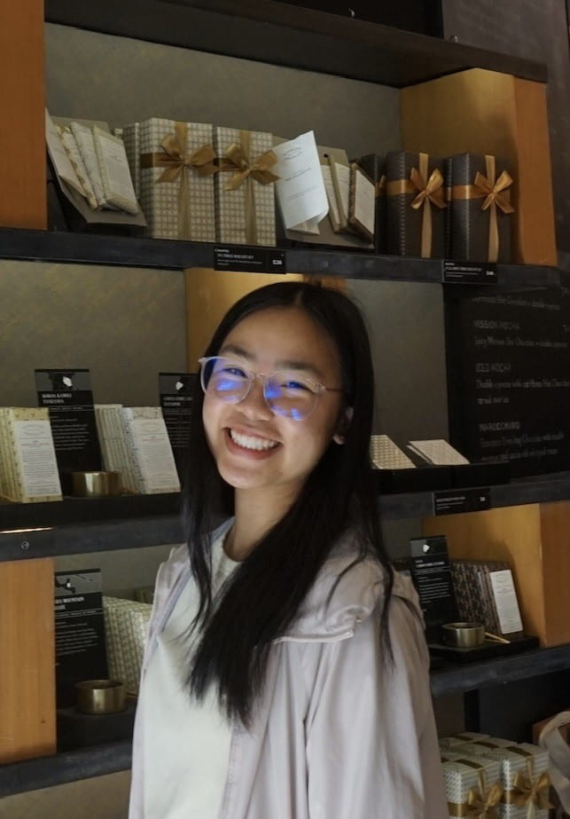</a></figure>

### Hailey Yuan

Hailey is a junior majoring in Electrical and Computer Engineering. Her research focuses on developing a graph-based framework that identifies dominant charge transport pathways in synthetic biological materials. In her free time, she enjoys eating, baking, and playing volleyball.

Email: hyuan8@uw.edu

</section>

<section class="team-member past-undergraduate-member" markdown="1">

<figure class="portrait"><a href="/images/997c8467-IMG_0237.jpg">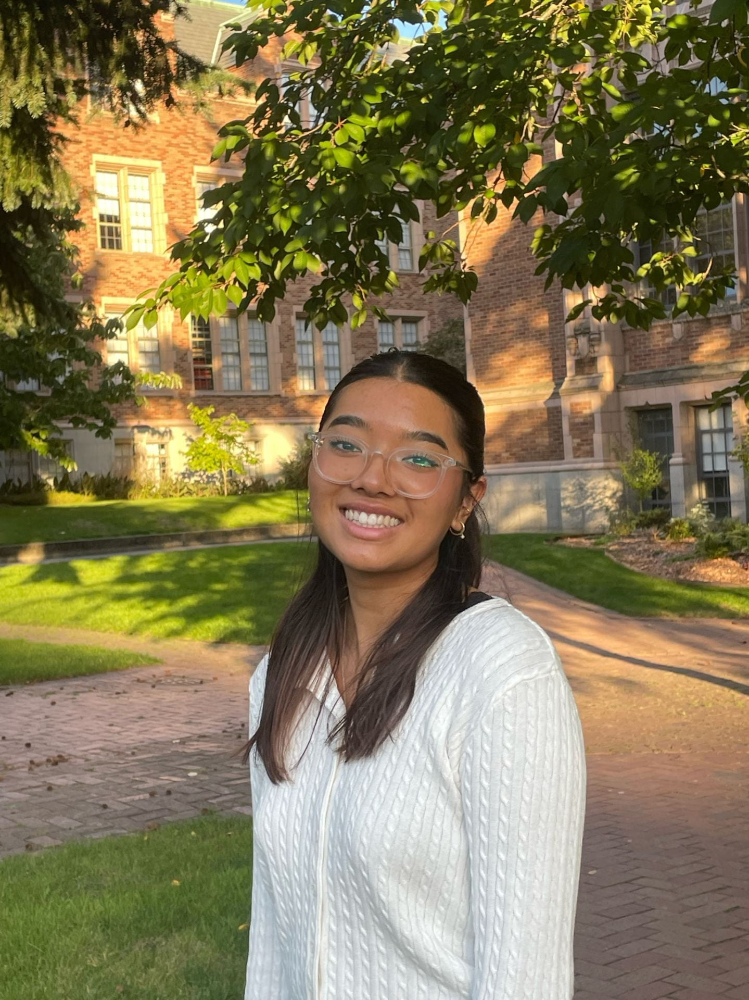</a></figure>

### Sara Kumar

Sara Kumar is currently completing her B.S. in Electrical and Computer Engineering at the University of Washington. She is planning to do a masters after graduation, hopefully also at UW. Her research focuses on the effects on metals in synthetic DNA strands using molecular dynamics simulations (MD).

Email: [skumar8@uw.edu](mailto:skumar8@uw.edu)

LinkedIn: <https://www.linkedin.com/in/sara-kumar1/>

</section>

<section class="team-member past-undergraduate-member" markdown="1">

<figure class="portrait"><a href="/images/e3c26d66-Photos-and-Bios-request-1.png">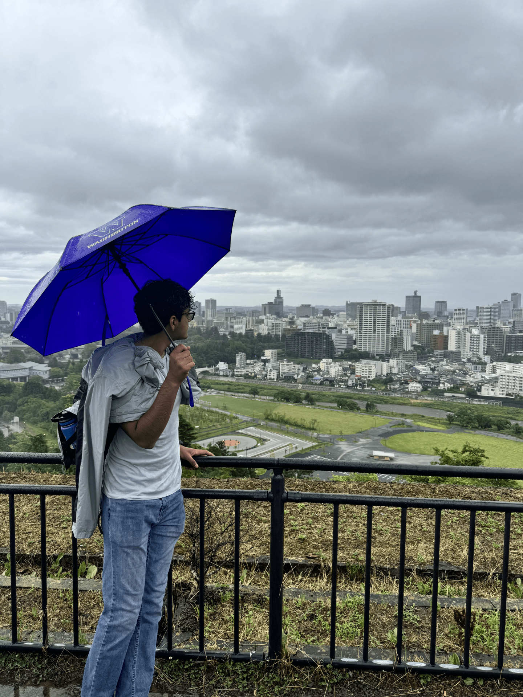</a></figure>

### Sachal Shaikh

Email: [sshaik@uw.edu](mailto:sshaik@uw.edu)

LinkedIn: <https://www.linkedin.com/in/sachal-shaikh>

</section>

<section class="team-member past-undergraduate-member" markdown="1">

<figure class="portrait"><a href="/images/4d263186-linkedinpic.jpg">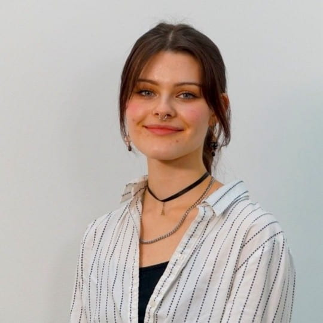</a></figure>

### Galina Petrova

Galina Petrova is a PhD student who joined in 2025. Her research focuses on charge transport in DNA, with a strong interest in quantum chemistry and molecular orbitals. In her free time, she enjoys solving Sudoku puzzles.​

</section>

<section class="team-member past-undergraduate-member" markdown="1">

<figure class="portrait"><a href="/images/8a6aa706-UW-Website-Theme-Update-2.jpg">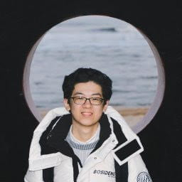</a></figure>

### Simon Cao

Simon Cao is a Ph.D. student in Anant’s group, having joined the group during his Master’s at UW, He currently works on semi-classical leaning problems, and will be moving into more quantum modeling problems for his Ph.D. His work currently includes some DFT calculations on 2D materials.

Email: [purunc@uw.edu](mailto:purunc@uw.edu)

Room: EEB 253D

LinkedIn: [https://www.linkedin.com/in/simoncaouw](https://www.linkedin.com/in/simoncaouw/)

</section>

<section class="team-member past-undergraduate-member" markdown="1">

<figure class="portrait"></figure>

### Yiren Wang

Yiren (Ethan) Wang was a 5th year PhD student in the Quantum Devices lab. He received his B.S. and M.S. degrees in Electrical and Computer Engineering from the University of Washington, in 2019 and 2021.

Email: [ethanwyr@uw.edu](mailto:ethanwyr@uw.edu)

LinkedIn: <https://www.linkedin.com/yi-ren-wang>

GitHub: <https://github.com/ethanwyr>

</section>



## Past High School Interns

<figure class="portrait"><a href="/images/207ec132-profile_photo.jpg">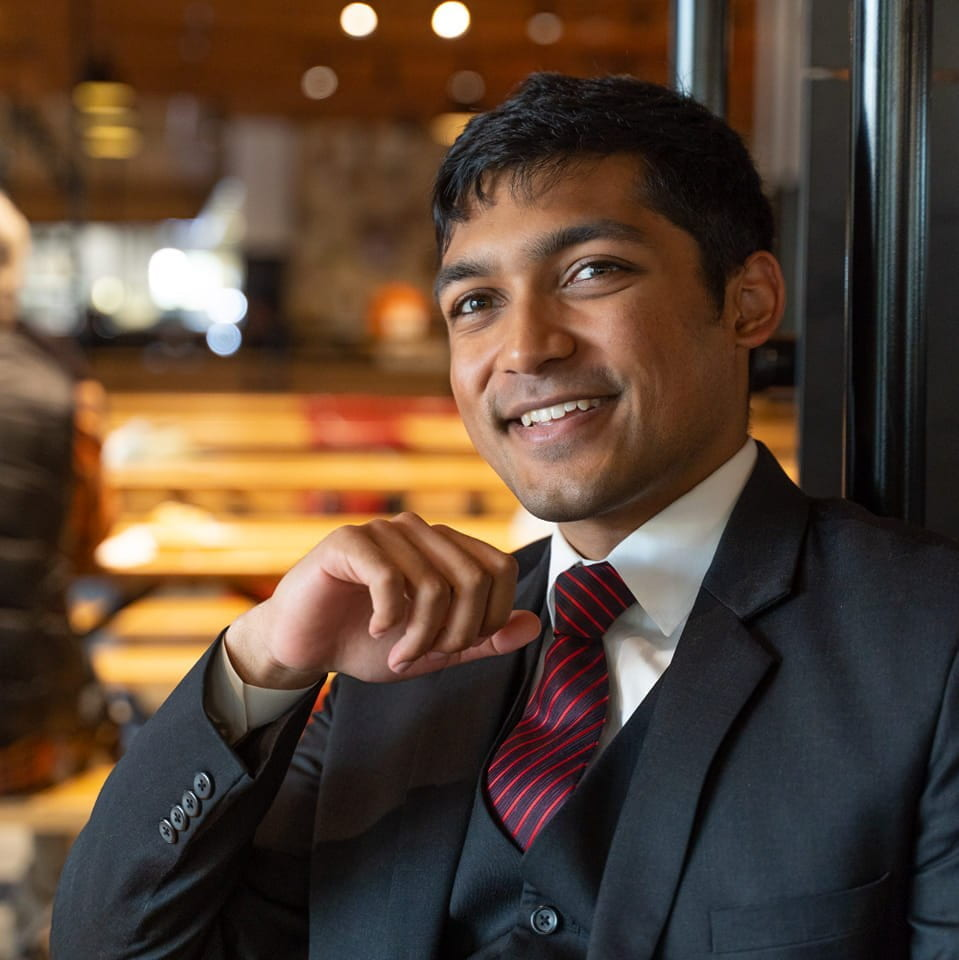</a></figure>

### Aditya Kumar

Aditya Kumar spent the summer of 2016 interning in Professor Anantram's lab. At that time the group was working on running simulations of RRAM (RAM cells that stored bits in their own crystalline structure rather than as a voltage), building on a matlab program that could simulate these cells running on HYAK (UW's supercomputer). He wrote a job scheduler that would distribute simulation workloads among each of the workstations and email return reports--his first experience with distributed systems programming, a large part of the his professional work today. He also helped revise lab materials for EE215: Intro to Electrical Engineering, a course he later took as an undergraduate student in UW's Computer Engineering program.

<figure class="portrait"><a href="/images/659b0f36-prathamesh_trivedi.jpeg">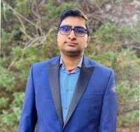</a></figure>

### Prathamesh Trivedi

Prathammesh Trivedi attended the Academy for Mathematics, Science, and Engineering in Rockaway, New Jersey while making edits to Prof. Anantram's lecture notes and working on topics like bandgaps and quantum materials. He is currently attending the University of California, Berkeley for Electrical Engineering and Computer Sciences.

<figure class="portrait"><a href="/images/8df972a1-Jessica-headshot-lower-res.jpeg">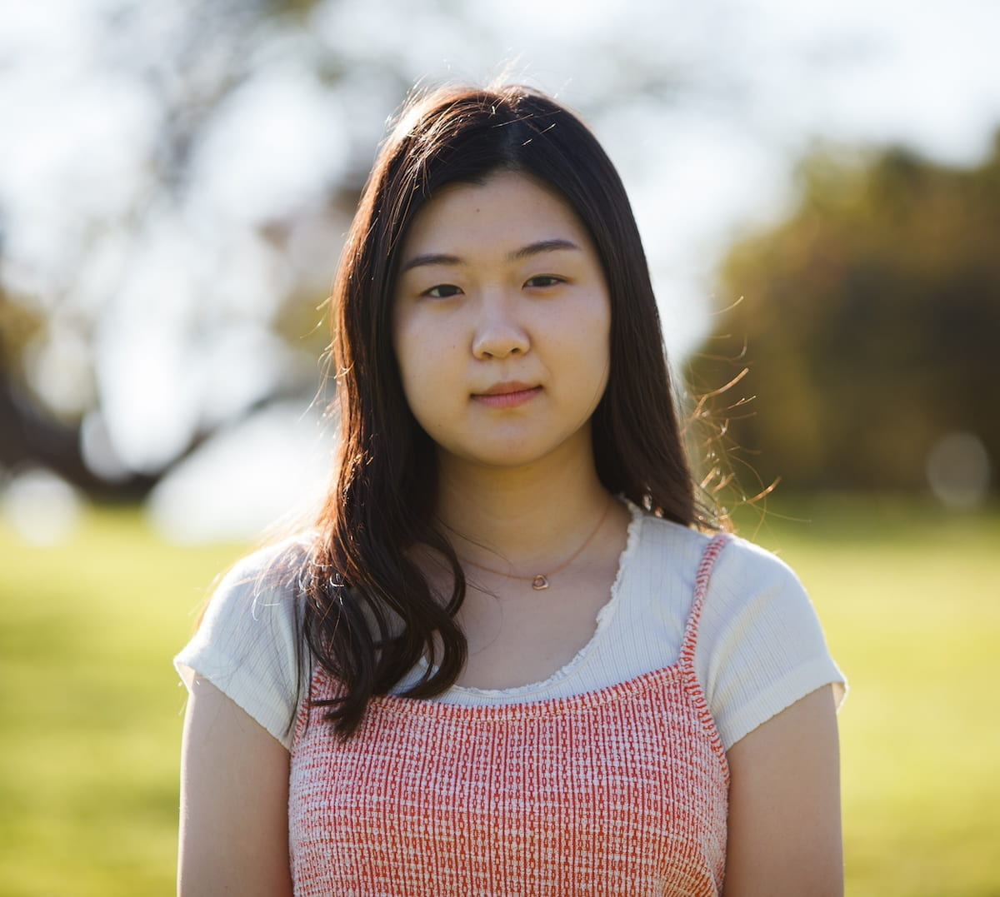</a></figure>

### Jessica Kim

Jessica Kim of La Canada High School and MIT was a Technical Writing Intern to edit Dr. Anantram's in-progress Quantum Mechanics textbook, proposing accessibility edits, creating comprehensive chapter summaries, and proofreading equations and conceptual paragraphs. She also was a listener for the Quantum Mechanics class he was teaching at that time.

<figure class="portrait"><a href="/images/3f9c5efd-image0-e1737405084890.jpeg">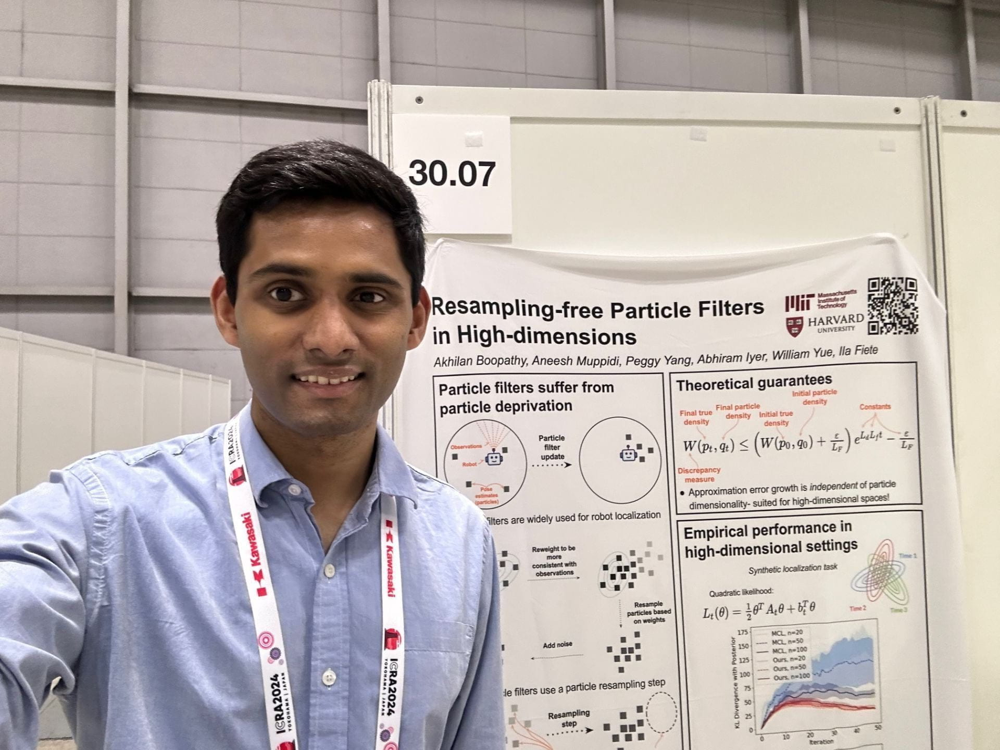</a></figure>

### Akhilan Boopathy

Akhilan Boopathy of the Lakeside School investigated the properties of novel nano-device geometries using a non-equilibrium Green’s function (NEGF) approach. He also investigated methods for reducing the computational cost of NEGF.

<figure class="portrait"><a href="/images/915ad288-IMG_1472.jpg">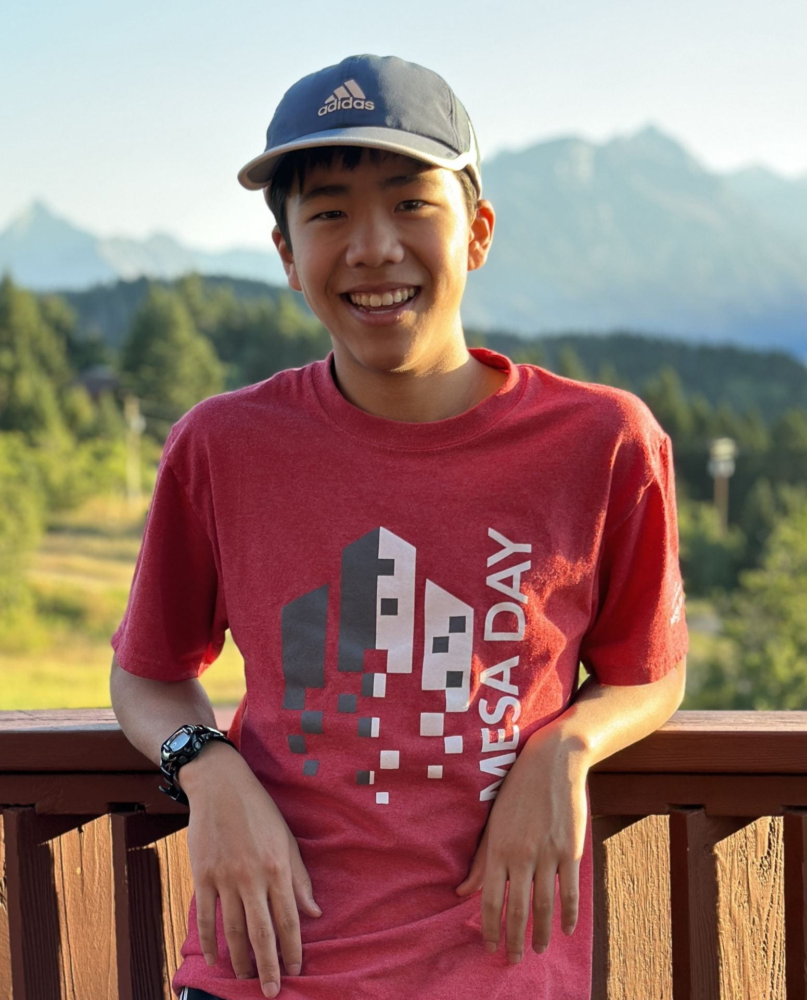</a></figure>

### Keon Louie

Keon Louie of Stadium High School edited and proofread equations, text, and figures in Professor Anantram's online textbook chapters and added additional chapters by transcribing online video lectures.

<figure class="portrait"><a href="/images/fccdde42-IMG_9586.jpeg">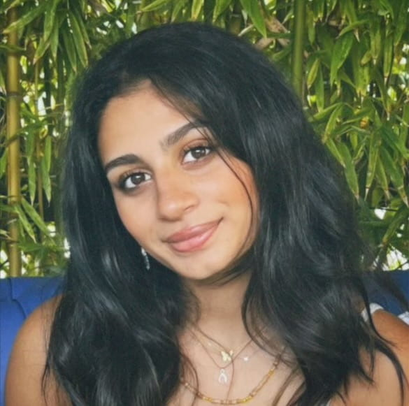</a></figure>

### Diya Kumar

Diya Kumar of Eastlake High School and Caltech worked on editing Prof. Anantram's quantum mechanics textbook. This included coming up with and creating diagrams for the book that would aid in understanding, checking the mathematical steps in the calculations presented in the book, and adjusting the flow of the writing to make sure the textbook was both engaging and useful for readers.

<figure class="portrait"><a href="/images/2d2cc2a2-HariniThiagarajan.jpg">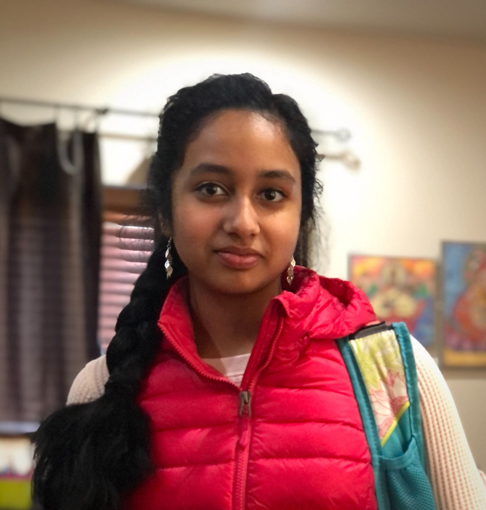</a></figure>

### Harini Thiagarajan

Harini Thiagarajan of North Creek High School and MIT worked on a traditional classifier method in DNA classification are limited to additional preprocessing and the input of SMBJ-averaged histogram data. This study highlights an SNN implementation to classify DNA strands built on SMBJ conductance values in real-time. She presented an abstract and poster at IEEE Conference held at Princeton University in March 2024.

<figure class="portrait"><a href="/images/032c6e29-IMG_5268.jpeg">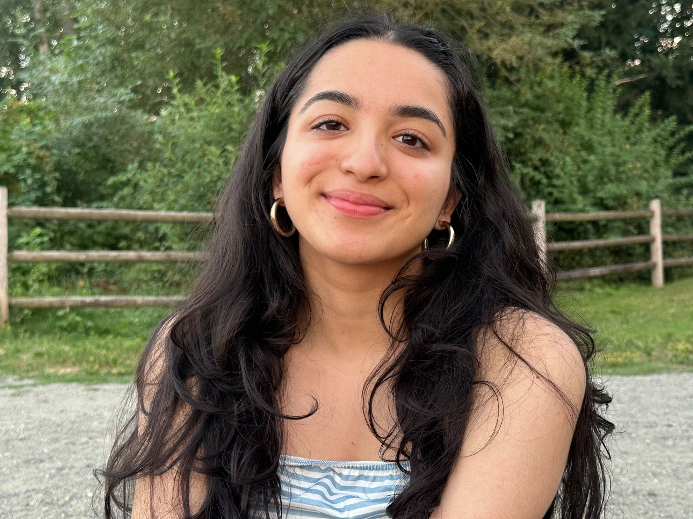</a></figure>

### Mrunal Shenoy

Mrunal Shenoy of Juanita High School and UCLA worked primarily on the technical writing and editing aspects for Dr. Anantram’s textbook while also creating several diagrams and graphs to help readers enhance their understanding of the written material, strengthening her upper level mathematics skills and encouraged her to pursue studies in Applied Mathematics.

<figure class="portrait"><a href="/images/598be219-IMG_4884.jpeg">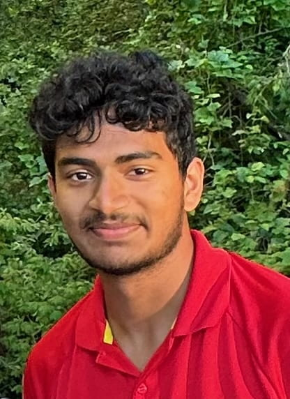</a></figure>

### Daksh Gupta

Daksh Gupta attended Interlake High School while working on large language models for forward and inverse materials design, generating and validating predictions for bandgaps and atomic structures. He is now studying Mathematics and Computer Science at the University of Oxford.

<figure class="portrait"><a href="/images/1ab02e3d-945dbd6d-ce25-4ea9-88a1-ea35bd35a822.jpg">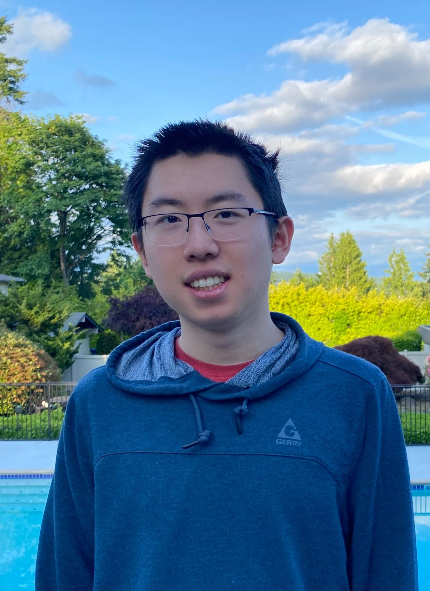</a></figure>

### Albert Zhan

Albert Zhan of Interlake High School worked on writing a review article on material and structural developments of nanopore sequencing of DNA. This covered graphene alternatives and 3D conical structures of nanopores.

<figure class="portrait"><a href="/images/11572989-o3.jpg">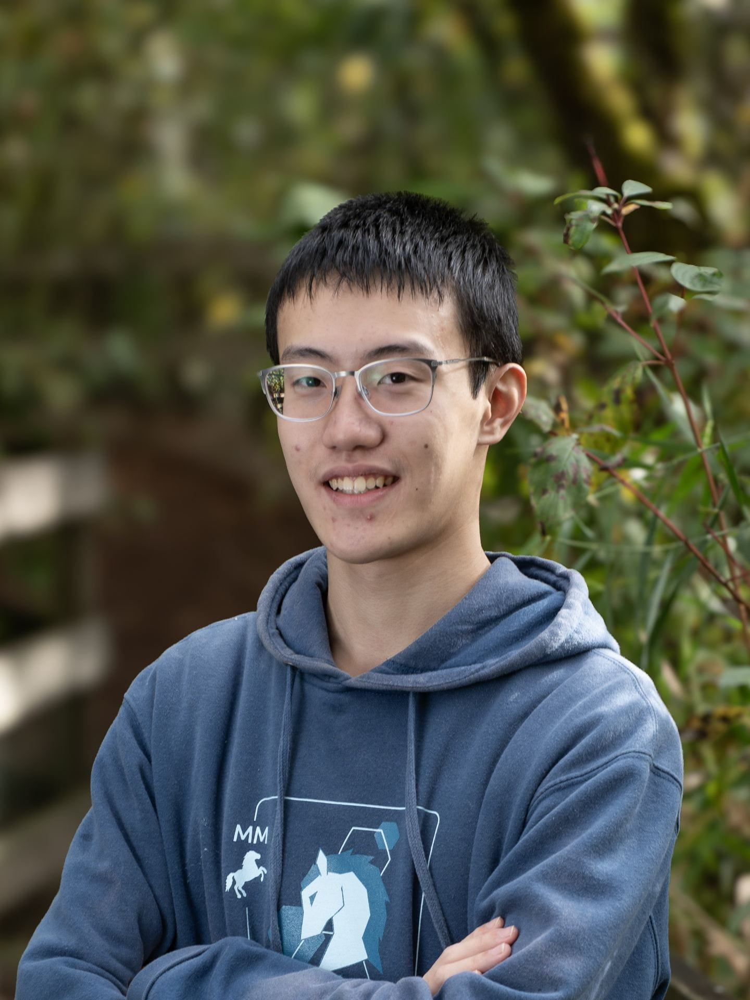</a></figure>

### Daniel Lu

Daniel Lu attended Interlake High School while developing this website and making lecture transcriptions for EE 539. He is currently studying computer engineering at UW.

<figure class="portrait"><a href="/images/453b0cca-20230701_1613182-1-2.jpg">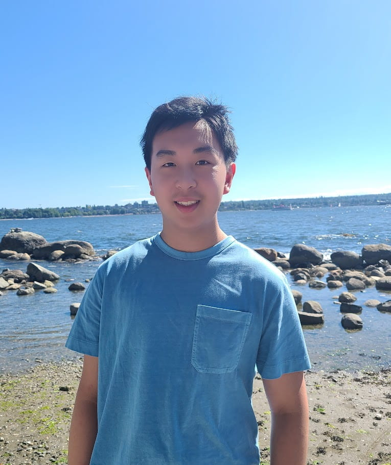</a></figure>

### Hongning Wang

Hongning Wang was a student in Eastlake High School and matriculated into university in 2025. He has been working in Anant’s group since June 2022 on both research and educational projects related to computer science/computation and applied physics.

<figure class="portrait"><a href="/images/9e5b771d-Amey-Bharambe-Quantum-Devices-Lab-e1758782614415.jpg">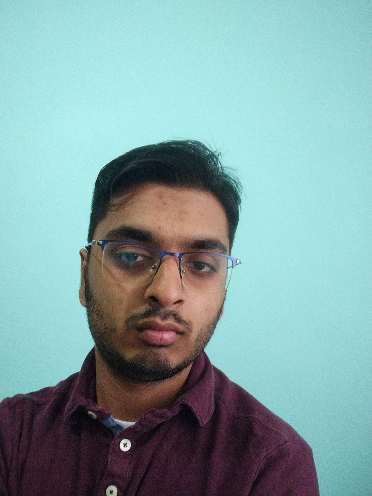</a></figure>

### Amey D Bharambe

Amey Bharambe was a summer intern in 2025 at the Quantum Devices Lab. He worked on developing machine learning models developed machine learning models to construct reduced-order Hamiltonians for DNA strands, designing neural networks that enforced Hermitian structure, coupling constraints, and eigenvalue fidelity. He also implemented physics-informed loss functions to incorporate density of states and transport characteristics. At the end of his internship, Amey presented his research findings to the Quantum Devices Lab, delivering technical slides that detailed his methodology, model comparisons, and implications for bio-inspired quantum device design.

<figure class="portrait"><a href="/images/aeac89b5-thumbnail_image0.jpg">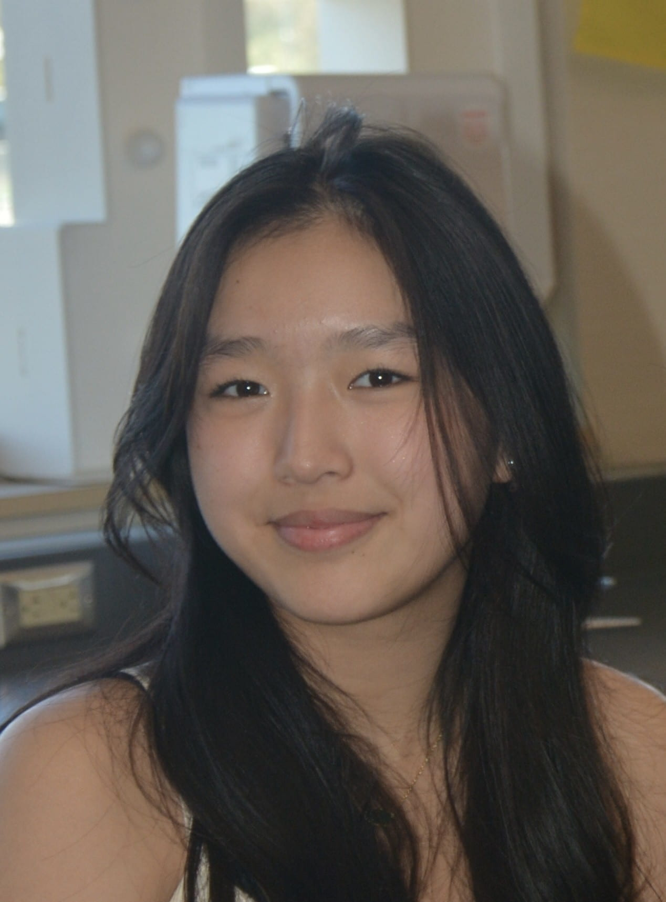</a></figure>

### Audrey Hong

My name is Audrey Hong, a senior at Bellevue High School. I enjoy exploring intersections of math and physics. Outside of academics, I have been a ballet dancer since age three and enjoy going to the gym!

<figure class="portrait"><a href="/images/2bf20e93-Screenshot-2025-09-21-125122.png">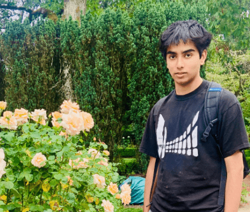</a></figure>

### Varun Patankar

Varun Patankar is a student at Juanita High School, graduating in 2027. His research focuses on DNA circuits and ionization potential for nitrogenous bases. He hopes to pursue electrical or computer engineering in college. In his free time, he enjoys building electronic circuits and math, as well as playing badminton.

<figure class="portrait"><a href="/images/67c6ed54-intern-photo.png">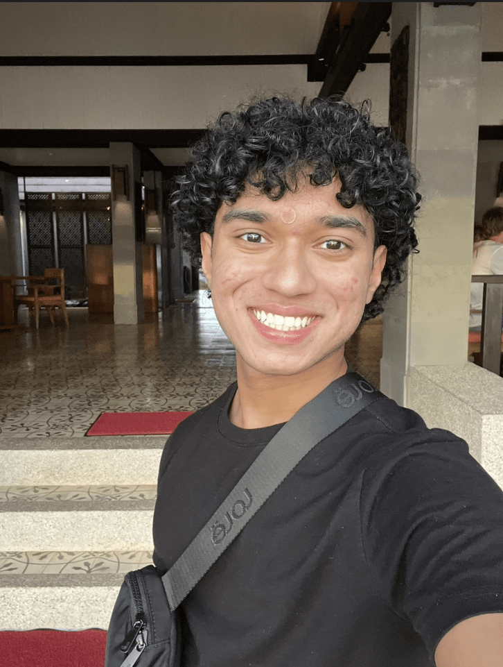</a></figure>

### Ibrahim Ansari

Ibrahim Ansari is interested in cognitive science, machine learning, and designing technology around human behavior and understanding. At the UW Quantum Devices Lab, he improved accessibility in quantum mechanics coursework by using AI-based tools to evaluate and refine course materials. He enjoys applying technical tools to real educational problems and actively seeks out opportunities that push him beyond his comfort zone.

<figure class="portrait"><a href="/images/cb6fe13b-SENIOR-PORTRAIT-039-2.jpg">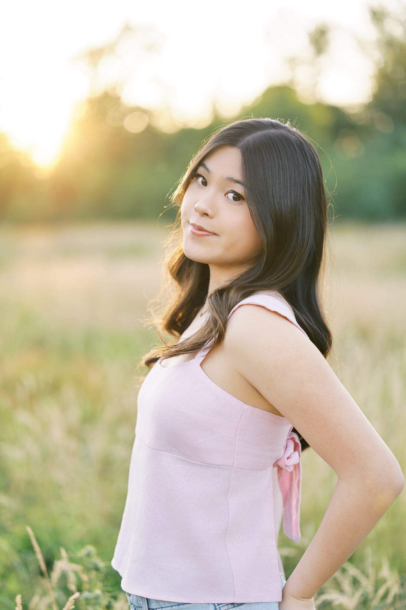</a></figure>

### Eireen Lee

This past summer, I had the opportunity to work with Professor Anantram’s Team, where I gained valuable experience in both marketing and research. Through close collaboration with my team members, we researched and designed infographics and user stories to promote UW Educational offerings. I am grateful for the chance to learn and for the supportive and enriching environment they created throughout the internship.

## Other Past High School Interns:

2025:

- Arman Alborzi
- Guhan Thiagarajan

2023:

- Hrishikesh Seshadri
- Austin Hong
- Oguz Tanatar

2022:

- Ashwin Kaliyaperumal
- Rose Liu
- Austin Hong

2021:

- Vikram Khandelwal
- Sophia Gershaft

2018:

- Grace Kim

2015:

- Hemil Gajjar


