[Past members](/team/past-team/) · [Group photos](/photos/) · [Join the group](/join/)

<figure class="group-photo"><a href="/images/10d096fb-Mt.-Ranier-GROUP-PHOTO.jpg">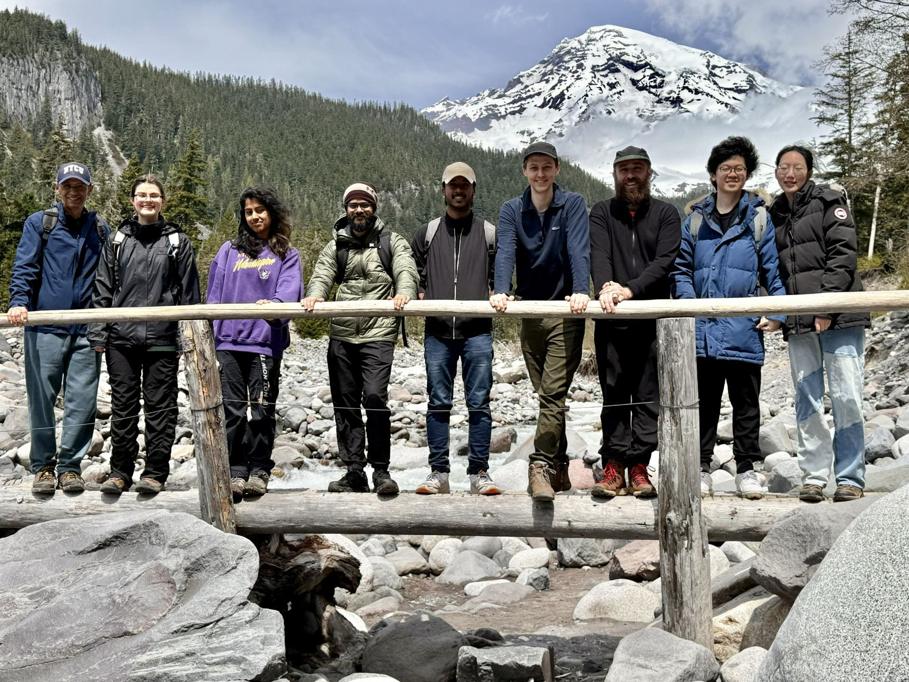</a></figure>

<section class="team-member" markdown="1">

<figure class="portrait"><a href="/images/a8d8cf96-Anant-Photo-2024-08-28.jpg">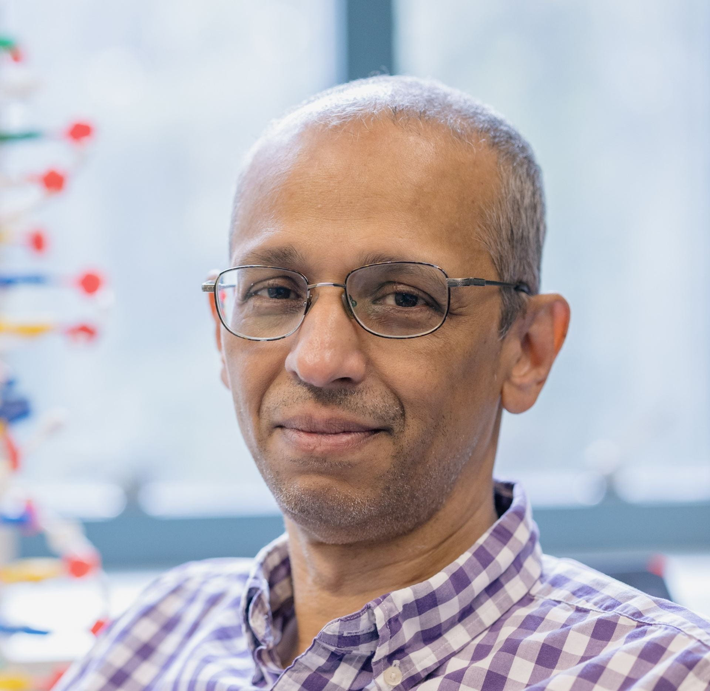</a></figure>

### M. P. Anantram (Anant)

M. P. Anantram (Anant) is a Professor of Electrical Engineering, and an Adjunct Professor of Physics at University of Washington (UW). Anantram’s group at UW currently works on the study of charge transport in biological molecules, 2D materials, formation of filaments and phase change in devices, and on theory and algorithms for modeling nanoscale materials and devices. His group has developed some of the fastest methods to calculate electron density and current in devices using direct methods based on the NEGF approach. They have also performed novel computational studies on the electromechanical properties of quasi one-dimensional nanowires and demonstrated the role of drain-end scattering in nanotransistors and noise properties of normal-superconductor junctions. His research efforts have predicted a significant chirality dependent bandgap change in carbon nanotubes and a large change in spontaneous emission rates in silicon nanowires with strain. More recently, his group has been involved in developing methods to understand charge transport in biological molecules and their application in electronic devices and electrical methods for disease detection and sequencing. Anantram earned his B.Sc. in Applied Science from P.S.G. College of Technology, M.Sc. in Physics from University of Pune, and Ph.D. in Engineering from Purdue University. Prior to joining UW, his experience included working at the NASA’s Center for Nanotechnology and serving as Professor at the University of Waterloo. Anantram has also served as an Associate Editor for IEEE Transactions on Nanotechnology and chair of the Modeling and Simulation Committee of the IEEE Nanotechnology Council. He currently serves as an editor of IEEE Transactions on Electron Devices and member of the Modeling and Simulation Committee of the IEEE NTC. He recently published a book titled Quantum Mechanics for Engineers and Material Scientists.

LinkedIn: [(Anant) M. P. Anantram - University of Washington, Seattle](https://www.linkedin.com/in/anant-m-p-anantram-5451599)

</section>

## Post-doctoral Fellows

<section class="team-member" markdown="1">

<figure class="portrait"><a href="/images/bfb60556-UW-Website-Theme-Update.jpg">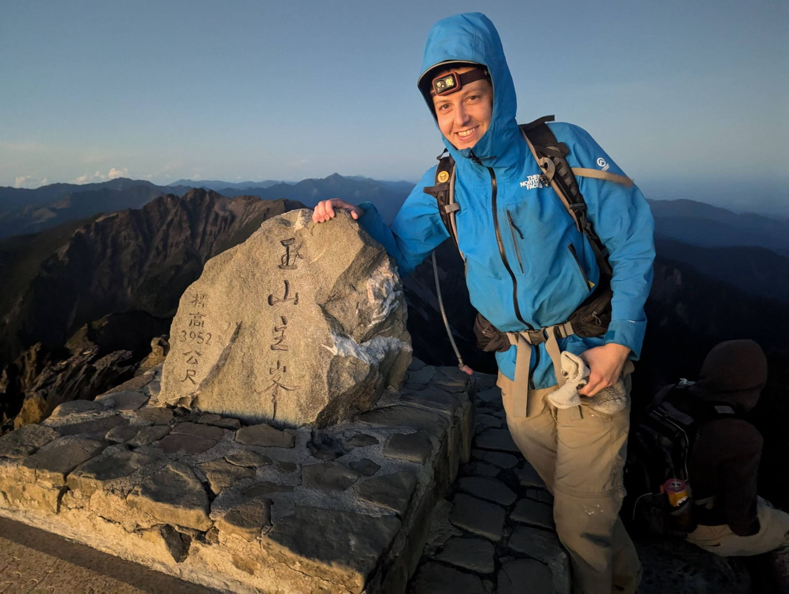</a></figure>

### William Livernois

William Livernois was a 5th year PhD student in the Quantum Devices lab. William’s work includes developing quantum transmission models for biological systems such as cytochromes, investigating spin-dependent transport mechanisms in biological systems, and applying ab-initio modeling to metal-modified DNA structures. Prior to his PhD, William earned dual B.S. degrees in Chemical Engineering and Physics from MIT before working in industry as an R&D engineer for four years. His work focused on optimizing chemical vapor deposition systems for nanomaterials synthesis and developing characterization methods for quality control.

Email: [willll@uw.edu](mailto:willll@uw.edu)

LinkedIn: <https://www.linkedin.com/in/willlivernois>

GitHub: <https://github.com/wliverno>

</section>

<section class="team-member" markdown="1">

<figure class="portrait"><a href="/images/ddb91d8d-IMG_20240110_141045-1.jpg">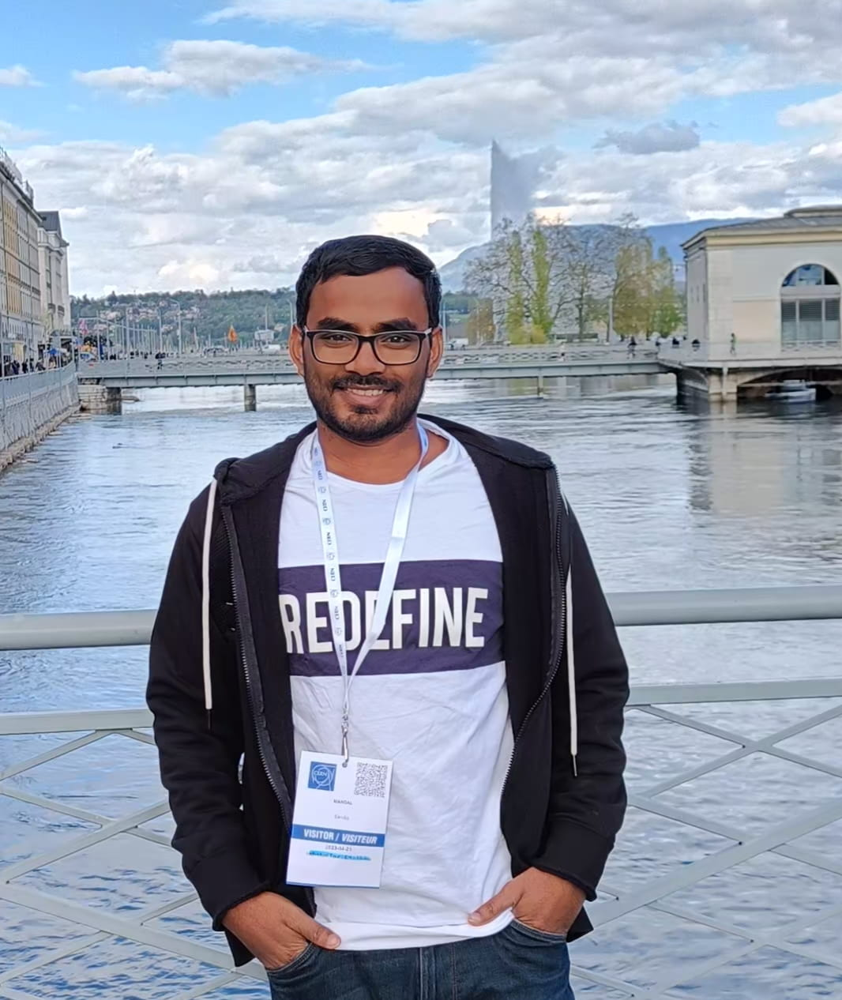</a></figure>

### Sandip Mandal

Sandip Mandal is a Computational Biophysicist with a PhD from the Indian Institute of Science (IISc), Bangalore India, specializing in DNA Nanotechnology and Molecular Dynamics Simulations. His current research combines Computational Modeling and Machine Learning to study DNA nanostructures, DNA-nanomaterial interactions, molecular charge transport, and biomolecular dynamics.

Email: [sm750@uw.edu](mailto:sm750@uw.edu)

LinkedIn: <https://www.linkedin.com/in/sandip-mandal-5b2a2114a/>

GitHub: <https://github.com/sandip18462>

Google Scholar: <https://scholar.google.com/citations?hl=en&user=C3fn3SQAAAAJ>

ResearchGate: <https://www.researchgate.net/profile/Sandip-Mandal-5>

</section>

## PhD Students

<section class="team-member" markdown="1">

<figure class="portrait"><a href="/images/8a199b48-WhatsApp-Image-2024-10-03-at-14.33.11_efdd5b5f.jpg">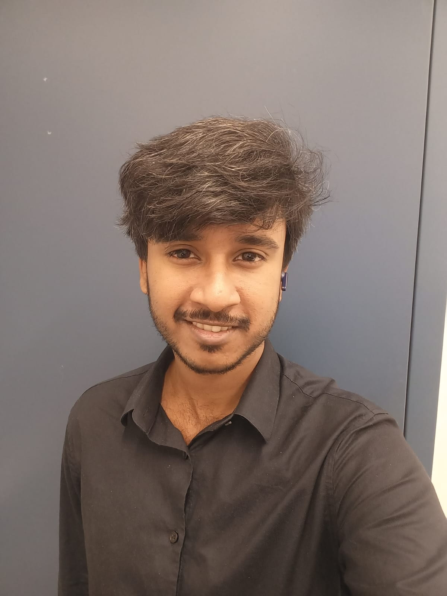</a></figure>

### Arpan De

Arpan De has always had a deep interest in physics, but he also obtained a BS in electrical engineering degree from Jadavpur University. He works on both the physics and invention of memory devices as part of our group.

</section>

<section class="team-member" markdown="1">

<figure class="portrait"><a href="/images/3f80ffde-unnamed-1.jpg">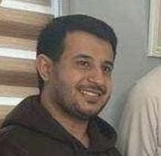</a></figure>

### Olayian Alolayian

After a BS and MS in electrical engineering from Saudi Arabia and the USA respectively, Olayian Alolayian worked in the industry for a few years. He is leading the effort in molecular dynamics (MD) simulations and studies a variety of phenomena using these simulations.

</section>

<section class="team-member" markdown="1">

<figure class="portrait"><a href="/images/2b5441ab-unnamed-e1726808405624.jpg">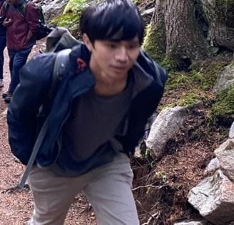</a></figure>

### Shiang-Bing Chiu

Shiang-Bin Chiu has a BS in electrical engineering and MS in physics. In our group, he works on topologically engineered DNA nanostructures and plans to work on decoherence models in future.

</section>

<section class="team-member" markdown="1">

<figure class="portrait"><a href="/images/8a6aa706-UW-Website-Theme-Update-2.jpg">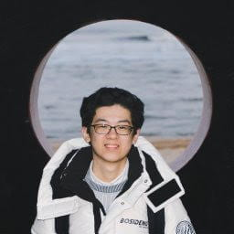</a></figure>

### Simon Cao

Simon Cao is a Ph.D. student in Anant’s group, having joined the group during his Master’s at UW, He currently works on semi-classical leaning problems, and will be moving into more quantum modeling problems for his Ph.D. His work currently includes some DFT calculations on 2D materials.

Email: [purunc@uw.edu](mailto:purunc@uw.edu)

Room: EEB 253D

LinkedIn: [https://www.linkedin.com/in/simoncaouw](https://www.linkedin.com/in/simoncaouw/)

</section>

<section class="team-member" markdown="1">

<figure class="portrait"><a href="/images/4d263186-linkedinpic.jpg">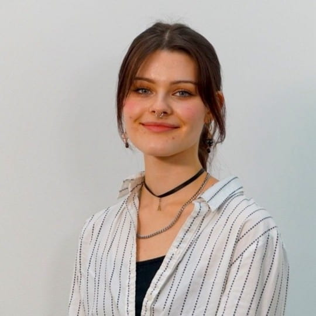</a></figure>

### Galina Petrova

Galina Petrova is a PhD student who joined in 2025. Her research focuses on charge transport in DNA, with a strong interest in quantum chemistry and molecular orbitals. In her free time, she enjoys solving Sudoku puzzles.​

</section>

## MS Students

<section class="team-member" markdown="1">

<figure class="portrait"></figure>

### Ting-Cheng Tuan

Ting-Cheng Tuan is an M.S. student in Electrical and Computer Engineering at the University of Washington. His research focuses on molecular dynamics simulations of metal-mediated DNA base pairs, particularly C–Ag⁺–C systems, to investigate their structural and thermal stability. His research interests include computational modeling, molecular simulation, and metal–DNA interactions.

</section>

## Undergrad Students

<section class="team-member" markdown="1">

<figure class="portrait"><a href="/images/81615061-IMG_2022.jpg">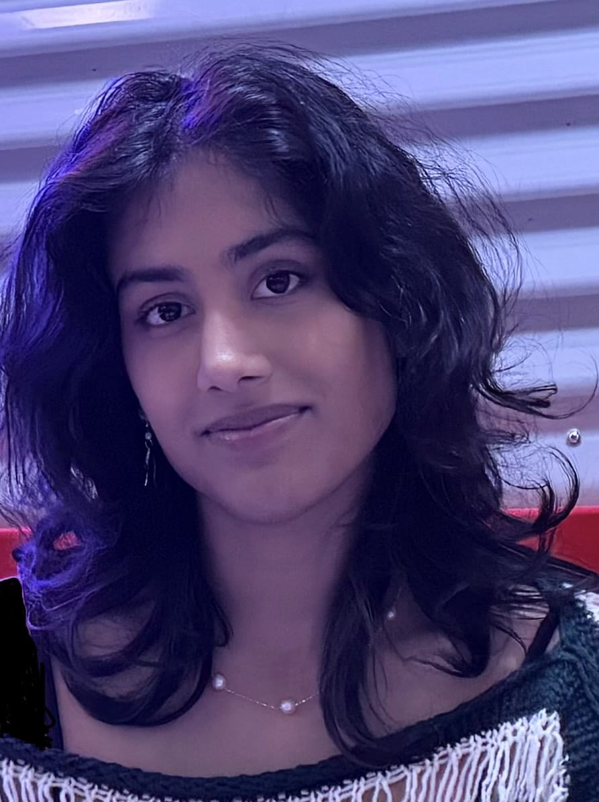</a></figure>

### Keya Joy

Keya A. Joy is a junior double-majoring in Electrical & Computer Engineering, and Mathematics. She is focusing on metal atom intercalation and diffusion through 2D materials. Her hobbies include climbing, creating art in several mediums, and traveling!

Email:  [kjoy@uw.edu](mailto:kjoy@uw.edu)

</section>

<section class="team-member" markdown="1">

<figure class="portrait"><a href="/images/7c795cd0-hyuan.jpg">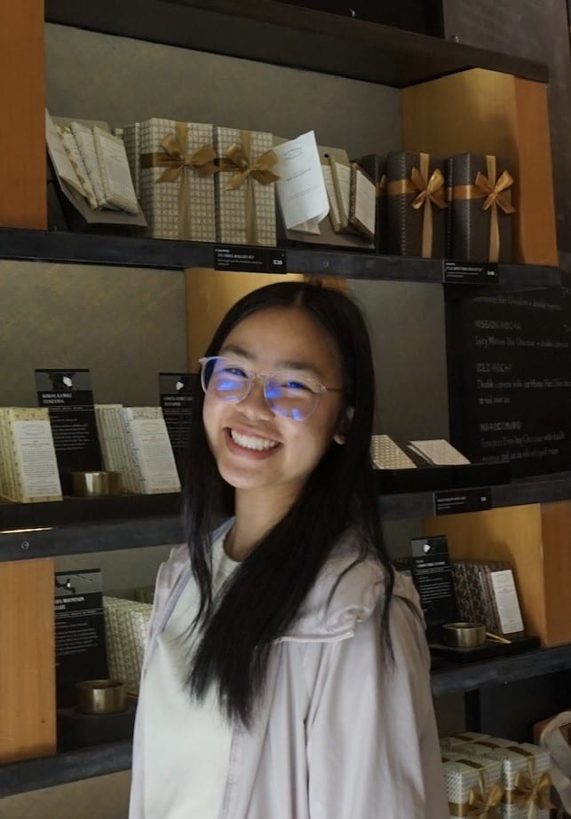</a></figure>

### Hailey Yuan

Hailey is a junior majoring in Electrical and Computer Engineering. Her research focuses on developing a graph-based framework that identifies dominant charge transport pathways in synthetic biological materials. In her free time, she enjoys eating, baking, and playing volleyball.

Email: hyuan8@uw.edu

</section>
